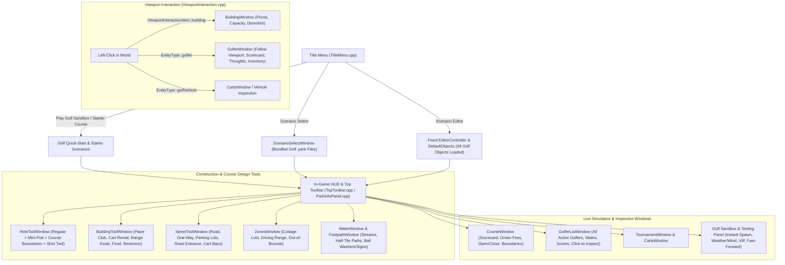

# Open Golf Simulator — In-Game Navigation & Gameplay Testing Plan

## 1. Executive Summary & Root-Cause Diagnosis

Although the backend simulation engines (`GolfDirector`, `BallPhysics`, `GolferAI`, `TrafficNetwork`, `CartDispatch`, `Tournament`, `ZoneGrid`, `HoleGeometry`) and their GoogleTest unit tests are implemented, **the game cannot currently be navigated or play-tested from the UI**.

An audit of the UI (`src/openrct2-ui/`) and runtime wiring (`src/openrct2/`) revealed **seven critical blockers** separating the player from the simulation:

1. **No Playable Entry Point (Empty Scenario Select & Broken Scenario Editor)**
   - Clicking **Start a New Game** on [`TitleMenuWindow`](file:///home/lucas/Documents/OpenRCT2/src/openrct2-ui/windows/TitleMenu.cpp#L135-L137) opens [`ScenarioSelectWindow`](file:///home/lucas/Documents/OpenRCT2/src/openrct2-ui/windows/ScenarioSelect.cpp), which scans for legacy RCT1/RCT2 scenarios. No `.park` golf scenarios exist, leaving the list empty.
   - Creating a park via **Scenario Editor** fails because:
     - [`kCommonScenarioAndTrackDesignerObjects`](file:///home/lucas/Documents/OpenRCT2/src/openrct2/object/DefaultObjects.cpp#L30-L48) only auto-selects terrain surfaces, one terrain edge, and climate—none of the `golf.building.*`, `golf.street.*`, `golf.stream.*`, `golf.vehicle_model.*`, `golf.golfer_model.*`, `golf.animal.*`, `golf.scenery_small.*`, `golf.path_addition.*`, or footpath objects are loaded by default.
     - [`EditorObjectSelectionWindow`](file:///home/lucas/Documents/OpenRCT2/src/openrct2-ui/windows/EditorObjectSelection.cpp#L174-L226) defines 10 entries in `kTerrainObjectSubTabs` (indices `0..9`), but only 7 sub-tab widgets (`WIDX_SUB_TAB_0` through `WIDX_SUB_TAB_6`). Sub-tabs `7`, `8`, and `9` (`golferModel`, `animal`, `street`) are unreachable and cause out-of-bounds widget array indexing in [`onDraw`](file:///home/lucas/Documents/OpenRCT2/src/openrct2-ui/windows/EditorObjectSelection.cpp#L1018-L1023).
     - [`Editor::CheckPark`](file:///home/lucas/Documents/OpenRCT2/src/openrct2/scenes/editor/EditorController.cpp#L121-L163) blocks advancing past the Landscape Editor with `STR_NO_PARK_ENTRANCES` and `STR_PEEP_SPAWNS_NOT_SET` because it checks for legacy RCT2 theme-park gates and peep spawns instead of a Golf Club and road entrances.

2. **Simulation Gate: No Way to Place Buildings (`BuildingPlaceAction` Has No UI)**
   - In [`GolfRuntime::onTick`](file:///home/lucas/Documents/OpenRCT2/src/openrct2/golf/GolfRuntime.cpp#L1210-L1211), the entire golf simulation is gated behind `if (!_scan.hasClub) return;`.
   - However, [`BuildingPlaceAction`](file:///home/lucas/Documents/OpenRCT2/src/openrct2/actions/scenery/BuildingPlaceAction.cpp#L30) is never called anywhere in `src/openrct2-ui/` (its only call site is automatic VIP cottage construction in [`GolfRuntime.cpp`](file:///home/lucas/Documents/OpenRCT2/src/openrct2/golf/GolfRuntime.cpp#L1013)).
   - Because the player has no UI window or tool to place `golf.building.club_house` (or `cart_rental`, `driving_range_kiosk`, `food_truck`, `restroom`), `_scan.hasClub` is permanently `false` and **the golf simulation never ticks**.

3. **Unreachable Construction Tools (Streets, Streams, Half-Tile Paths, Course Boundaries, Mini-Putt)**
   - **Streets, Parking Lots & Cart Bays**: [`StreetToolOpen`](file:///home/lucas/Documents/OpenRCT2/src/openrct2-ui/windows/StreetTool.cpp#L334) is only reachable via an obscure console command (`open street_tool`). There is no button in [`TopToolbar.cpp`](file:///home/lucas/Documents/OpenRCT2/src/openrct2-ui/windows/TopToolbar.cpp) or [`Footpath.cpp`](file:///home/lucas/Documents/OpenRCT2/src/openrct2-ui/windows/Footpath.cpp) to open it.
   - **Streams**: [`StreamPlaceAction`](file:///home/lucas/Documents/OpenRCT2/src/openrct2/actions/scenery/StreamPlaceAction.cpp) and [`StreamRemoveAction`](file:///home/lucas/Documents/OpenRCT2/src/openrct2/actions/scenery/StreamRemoveAction.cpp) have zero callers in `src/openrct2-ui/`.
   - **Half-Tile Paths & Path Additions**: [`FootpathLayoutPlaceAction`](file:///home/lucas/Documents/OpenRCT2/src/openrct2/actions/footpath/FootpathLayoutPlaceAction.cpp) has zero callers in `src/openrct2-ui/`, and `golf.path_addition.ball_washer` / `golf.path_addition.path_sign` `.parkobj` files are missing from `data/object/golf/path_addition/`.
   - **Mini-Putt & Course Boundaries**: [`HoleToolWindow`](file:///home/lucas/Documents/OpenRCT2/src/openrct2-ui/windows/HoleTool.cpp#L190) hardcodes `CourseEditType::create` to `CourseKind::regular` with no way to create a `CourseKind::miniPutt` course, and [`CourseBoundaryAction`](file:///home/lucas/Documents/OpenRCT2/src/openrct2/actions/golf/CourseBoundaryAction.cpp) has zero callers in `src/openrct2-ui/`.

4. **Broken Viewport Clicking on Buildings, Golfers, Carts, and Animals**
   - In [`ViewportInteractionGetItemLeft`](file:///home/lucas/Documents/OpenRCT2/src/openrct2-ui/interface/ViewportInteraction.cpp#L108-L158), the `switch (info.interactionType)` only handles `entity`, `ride`, and `parkEntrance`, and its `default:` branch overwrites `info.interactionType = ViewportInteractionItem::none;`!
   - Consequently, even though [`PaintBuilding`](file:///home/lucas/Documents/OpenRCT2/src/openrct2/paint/tile_element/Paint.Building.cpp#L61) sets `ViewportInteractionItem::building`, [`ViewportInteractionGetItemLeft`](file:///home/lucas/Documents/OpenRCT2/src/openrct2-ui/interface/ViewportInteraction.cpp#L156) wipes it out before [`ViewportInteractionLeftClick`](file:///home/lucas/Documents/OpenRCT2/src/openrct2-ui/interface/ViewportInteraction.cpp#L259) is called. Clicking a building never opens [`BuildingWindow`](file:///home/lucas/Documents/OpenRCT2/src/openrct2-ui/windows/Building.cpp).
   - Furthermore, [`GolferEntity::create`](file:///home/lucas/Documents/OpenRCT2/src/openrct2/entity/GolferEntity.cpp#L35-L37) sets `spriteData.heightMin = 0, heightMax = 16` (extending downward below the feet rather than upward to the head), and [`ViewportInteractionGetItemLeft`](file:///home/lucas/Documents/OpenRCT2/src/openrct2-ui/interface/ViewportInteraction.cpp#L111-L138) / [`ViewportInteractionGetClosestPeep`](file:///home/lucas/Documents/OpenRCT2/src/openrct2-ui/interface/ViewportInteraction.cpp#L163-L198) ignore `EntityType::golfer`.

5. **Top Toolbar & HUD Still Wired to Legacy RCT2 Systems**
   - Clicking **Guests** on the top toolbar opens [`GuestListWindow`](file:///home/lucas/Documents/OpenRCT2/src/openrct2-ui/windows/GuestList.cpp#L752), which iterates `EntityList<Guest>()` instead of `GolferEntity` / `GolfRuntime::director().simulation().golfers()`. It always shows 0 guests.
   - [`ParkInfoPanel`](file:///home/lucas/Documents/OpenRCT2/src/openrct2-ui/windows/ParkInfoPanel.cpp#L117-L163) (bottom-left HUD) displays `gameState.park.numGuestsInPark` (always 0) and `gameState.park.rating` instead of active Golfer count and Golf Course Popularity/Satisfaction.
   - [`TopToolbar`](file:///home/lucas/Documents/OpenRCT2/src/openrct2-ui/windows/TopToolbar.cpp) uses legacy RCT2 ride tooltips (`STR_BUILD_RIDE_TIP`, `STR_RIDES_IN_PARK_TIP`) and hides critical golf windows (`Zones`, `Tournament`, `Carts`, `BuildingTool`, `StreetTool`, `ShotTool`) either in nested sub-windows or solely in the text console.

6. **No In-Game Gameplay Testing / Sandbox Controls**
   - Several mechanics (tournaments occurring on specific calendar days, VIP cottage purchases, weather/wind changes, animal spawns, cart breakdowns, frost/rain turf transitions) require waiting for long simulation timers unless an interactive **Golf Sandbox / Testing Panel** is available in-game.

---

## 2. Architecture Overview of Proposed Changes

---

## 3. Phased Implementation Plan

### Phase 1: Instant Game Entry, Default Golf Objects & Starter Scenarios (`NAV-001` to `NAV-005`)

**Goal**: Allow the user to launch directly into a working, playable golf course (or clean sandbox with all objects loaded) with a single click from the Title Screen, and fix Scenario Editor park creation.

#### `NAV-001` — Auto-Load All Golf Objects in `DefaultObjects.cpp`
- **File**: [`src/openrct2/object/DefaultObjects.cpp`](file:///home/lucas/Documents/OpenRCT2/src/openrct2/object/DefaultObjects.cpp#L30-L48)
- **Changes**:
  - Expand `kCommonScenarioAndTrackDesignerObjects` (or add `kDefaultGolfObjects` loaded alongside it during new scenario/sandbox initialization) to include:
    - **Buildings**: `golf.building.club_house`, `golf.building.cart_rental`, `golf.building.driving_range_kiosk`, `golf.building.food_truck`, `golf.building.restroom`, `golf.building.cottage`
    - **Streets**: `golf.street.road`, `golf.street.one_way`
    - **Streams**: `golf.stream.creek`
    - **3D Models**: `golf.golfer_model.default`, `golf.vehicle_model.sedan`, `golf.vehicle_model.suv`, `golf.vehicle_model.sports`, `golf.vehicle_model.golf_cart`
    - **Animals**: `golf.animal.goose`, `golf.animal.deer`, `golf.animal.alligator`, `golf.animal.bird`, `golf.animal.squirrel`, `golf.animal.fish`
    - **Golf Scenery & Walls**: `golf.scenery_small.tree_oak`, `tree_pine`, `tree_maple`, `tree_weeping_willow`, `tree_palm`, `bush`, `flowers`, `garden_clock`, `golf.wall.brick_wall`, `hedge`, `stone_wall`, `wood_fence`, `wire_fence`
    - **Footpaths & Path Additions**: `rct2.footpath_surface.tarmac`, `rct2.footpath_surface.dirt`, `rct2.footpath_railings.wood`, `golf.path_addition.bench`, `golf.path_addition.bin`, `golf.path_addition.lamp`, `golf.path_addition.ball_washer`, `golf.path_addition.path_sign`

#### `NAV-002` — Generate Missing Golf Path Addition Objects (`ball_washer`, `path_sign`)
- **Files**:
  - [`scripts/placeholders/objects.py`](file:///home/lucas/Documents/OpenRCT2/scripts/placeholders/objects.py)
  - `data/object/golf/path_addition/golf.path_addition.ball_washer.parkobj`
  - `data/object/golf/path_addition/golf.path_addition.path_sign.parkobj`
- **Changes**:
  - Add placeholder `.parkobj` definitions for `golf.path_addition.ball_washer` (`ballWasher` subtype) and `golf.path_addition.path_sign` (`pathSign` subtype) in `data/object/golf/path_addition/` so they can be selected and placed on footpaths in-game.

#### `NAV-003` — Fix `EditorObjectSelectionWindow` Sub-Tab Out-of-Bounds Bug
- **File**: [`src/openrct2-ui/windows/EditorObjectSelection.cpp`](file:///home/lucas/Documents/OpenRCT2/src/openrct2-ui/windows/EditorObjectSelection.cpp#L75-L82)
- **Changes**:
  - Add `WIDX_SUB_TAB_7`, `WIDX_SUB_TAB_8`, `WIDX_SUB_TAB_9` to `WINDOW_EDITOR_OBJECT_SELECTION_WIDGET_IDX` and `_objectSelectionWidgets` so all 10 entries in `kTerrainObjectSubTabs` (`terrainSurface`, `terrainEdge`, `water`, `climate`, `stream`, `building`, `vehicleModel`, `golferModel`, `animal`, `street`) have valid buttons and tooltips without writing past `WIDX_SUB_TAB_6`.

#### `NAV-004` — Update `Editor::CheckPark` for Golf Courses
- **File**: [`src/openrct2/scenes/editor/EditorController.cpp`](file:///home/lucas/Documents/OpenRCT2/src/openrct2/scenes/editor/EditorController.cpp#L121-L163)
- **Changes**:
  - Remove the mandatory RCT2 theme-park entrance (`gameState.park.entrances.empty()`) and peep spawn (`gameState.peepSpawns.empty()`) checks in `Editor::CheckPark`.
  - Allow advancing to Scenario Options / normal play either on any valid terrain map (so the player can build their Clubhouse in-game) or when a Golf Club is present.

#### `NAV-005` — Add "Quick-Start Golf Sandbox" & Starter Golf Course to Title Menu
- **Files**:
  - [`src/openrct2-ui/windows/TitleMenu.cpp`](file:///home/lucas/Documents/OpenRCT2/src/openrct2-ui/windows/TitleMenu.cpp#L130-L175)
  - [`src/openrct2/golf/GolfRuntime.cpp`](file:///home/lucas/Documents/OpenRCT2/src/openrct2/golf/GolfRuntime.cpp)
- **Changes**:
  - When clicking **Start a New Game** on the Title Menu (or via a dedicated dropdown with **"Start Playable Demo Course"** and **"Start Empty Golf Sandbox"**):
    - **Playable Demo Course**: Initializes a flat/sculpted map with all default golf objects loaded, `$50,000` cash, an open park, a road connected from the map edge to a parking lot, a placed **Golf Club** (`golf.building.club_house`), **Cart Rental** (`golf.building.cart_rental`), **Driving Range Kiosk** (`golf.building.driving_range_kiosk`) + Driving Range zone, and a complete 3-hole starter course (Par 4, Par 3, Par 5 with tee, fairway, bunker, water hazard, green, and pin) + 1 Mini-Putt hole. Golfers immediately begin driving in, parking, checking in, and teeing off!
    - **Empty Golf Sandbox**: Initializes a clean grass map with all golf objects pre-loaded and `$100,000` starting cash so the player can build everything from scratch immediately.

---

### Phase 2: Top Toolbar & HUD Overhaul for Golf (`UI-001` to `UI-003`)

**Goal**: Make every golf construction and management tool immediately discoverable and accessible from the main game screen.

#### `UI-001` — Top Toolbar Dedicated Golf Menus & Buttons
- **File**: [`src/openrct2-ui/windows/TopToolbar.cpp`](file:///home/lucas/Documents/OpenRCT2/src/openrct2-ui/windows/TopToolbar.cpp)
- **Changes**:
  - Update the top toolbar buttons and dropdowns so every golf tool is 1 click away:
    - **Scenery / Buildings Button** (`WIDX_SCENERY`): Dropdown or direct tabs for **Golf Buildings** (`BuildingToolOpen`), **Trees & Scenery** (`SceneryOpen`), and **Zones (Cottages / Driving Range / OOB)** (`ZonesOpen`).
    - **Paths & Streets Button** (`WIDX_FOOTPATH`): Dropdown to choose **Footpaths & Course Paths** (`FootpathOpen`) or **Streets, Parking & Cart Bays** (`StreetToolOpen`).
    - **Hole & Course Construction Button** (`WIDX_CONSTRUCT_RIDE`): Opens `HoleToolOpen()` with proper golf tooltip (`"Build Golf Holes, Tees, Pins & Aim Points"`), plus dropdown option for **Shot Trajectory Planner** (`ShotToolOpen`).
    - **Courses & Operations Button** (`WIDX_RIDES`): Dropdown for **Courses & Scorecards** (`CourseOpen`), **Tournaments** (`TournamentOpen`), **Golf Carts Fleet** (`CartsOpen`), and **Zones & Lots** (`ZonesOpen`).
    - **Park / Facility Button** (`WIDX_PARK`): Includes **Finances**, **Course Overview**, **Tournaments**, and **Golf Sandbox / Testing Panel**.
    - **Golfers Button** (`WIDX_GUESTS`): Opens the updated [`GuestListWindow`](file:///home/lucas/Documents/OpenRCT2/src/openrct2-ui/windows/GuestList.cpp) showing active **Golfers**.

#### `UI-002` — Bottom-Left HUD (`ParkInfoPanel`) Live Golf Metrics
- **File**: [`src/openrct2-ui/windows/ParkInfoPanel.cpp`](file:///home/lucas/Documents/OpenRCT2/src/openrct2-ui/windows/ParkInfoPanel.cpp#L110-L240)
- **Changes**:
  - Replace `gameState.park.numGuestsInPark` with the live golfer count from `Golf::GetGolfRuntime()->director().simulation().golfers().size()` (falling back to `EntityList<GolferEntity>()` count).
  - Replace `gameState.park.rating` with Golf Course Popularity / Satisfaction (`director().popularity()` scaled `0..1000` or percentage display).
  - Clicking the Golfer count opens the Golfers list; clicking the Popularity bar opens `CourseWindow` or `ParkWindow`.

#### `UI-003` — Keyboard Shortcuts for Golf Windows
- **Files**:
  - [`src/openrct2-ui/input/ShortcutIds.h`](file:///home/lucas/Documents/OpenRCT2/src/openrct2-ui/input/ShortcutIds.h)
  - [`src/openrct2-ui/input/Shortcuts.cpp`](file:///home/lucas/Documents/OpenRCT2/src/openrct2-ui/input/Shortcuts.cpp)
- **Changes**:
  - Ensure standard hotkeys open the golf equivalents cleanly (e.g., Rides list shortcut opens `CourseWindow`, Build Ride shortcut opens `HoleToolWindow`, Guest List opens Golfers List).

---

### Phase 3: Missing Construction & Course Editing Tools (`TOOL-001` to `TOOL-005`)

**Goal**: Provide interactive UI tools and ghost previews for every `GameAction` that currently lacks a UI caller.

#### `TOOL-001` — Golf Building Placement Window (`BuildingToolWindow`)
- **Files**:
  - New window or mode in [`src/openrct2-ui/windows/Building.cpp`](file:///home/lucas/Documents/OpenRCT2/src/openrct2-ui/windows/Building.cpp) (`Windows::BuildingToolOpen()`)
  - [`src/openrct2-ui/windows/Windows.h`](file:///home/lucas/Documents/OpenRCT2/src/openrct2-ui/windows/Windows.h)
  - [`src/openrct2-ui/WindowManager.cpp`](file:///home/lucas/Documents/OpenRCT2/src/openrct2-ui/WindowManager.cpp)
- **Changes**:
  - Create a building construction window listing all loaded `ObjectType::building` entries (`Golf Club`, `Cart Rental`, `Driving Range Kiosk`, `Food Truck`, `Restroom`, `Cottage`).
  - Show building name, kind, footprint dimensions (`widthTiles x depthTiles`), placement cost (`Query` result of `BuildingPlaceAction`), and a **Rotate (`R` / button)** control (`Direction 0..3`).
  - Highlight the multi-tile footprint on the map using `MapSelectFlags::enable` (`gMapSelectPositionA` / `gMapSelectPositionB`) on `onToolUpdate`.
  - Execute [`BuildingPlaceAction(tileCoords, selectedEntryIndex, rotation)`](file:///home/lucas/Documents/OpenRCT2/src/openrct2/actions/scenery/BuildingPlaceAction.h) on `onToolDown`, and right-click or demolish button to run `BuildingRemoveAction`.

#### `TOOL-002` — Stream Placement & Removal in `WaterWindow`
- **File**: [`src/openrct2-ui/windows/Water.cpp`](file:///home/lucas/Documents/OpenRCT2/src/openrct2-ui/windows/Water.cpp)
- **Changes**:
  - Expand [`WaterWindow`](file:///home/lucas/Documents/OpenRCT2/src/openrct2-ui/windows/Water.cpp#L52) with a **Stream Tool** section:
    - Mode buttons: **Raise/Lower Water**, **Place Stream**, **Remove Stream**.
    - Flow Direction selector (`North`, `East`, `South`, `West` / Rotate button).
    - When **Place Stream** is active, clicking or dragging on terrain executes [`StreamPlaceAction(mapCoords, streamEntryIndex, flowDirection)`](file:///home/lucas/Documents/OpenRCT2/src/openrct2/actions/scenery/StreamPlaceAction.h).
    - When **Remove Stream** is active, clicking executes [`StreamRemoveAction(mapCoords)`](file:///home/lucas/Documents/OpenRCT2/src/openrct2/actions/scenery/StreamRemoveAction.h).

#### `TOOL-003` — Half-Tile Footpath Sub-Quads in `FootpathWindow`
- **File**: [`src/openrct2-ui/windows/Footpath.cpp`](file:///home/lucas/Documents/OpenRCT2/src/openrct2-ui/windows/Footpath.cpp)
- **Changes**:
  - Add a **Full Tile / Half-Tile (Sub-Quad)** toggle in [`FootpathWindow`](file:///home/lucas/Documents/OpenRCT2/src/openrct2-ui/windows/Footpath.cpp).
  - When Half-Tile mode is active, determine the hovered sub-quadrant (`0..3`) or edge mask from the sub-tile cursor offset and execute [`FootpathLayoutPlaceAction`](file:///home/lucas/Documents/OpenRCT2/src/openrct2/actions/footpath/FootpathLayoutPlaceAction.h) with the computed `subQuads` bitmask (`0x01..0x0F`).
  - Also add a quick button in `FootpathWindow` to open `StreetToolWindow` ("Switch to Street & Parking Tool").

#### `TOOL-004` — Mini-Putt Course Creation & Course Boundary Painting
- **Files**:
  - [`src/openrct2-ui/windows/HoleTool.cpp`](file:///home/lucas/Documents/OpenRCT2/src/openrct2-ui/windows/HoleTool.cpp)
  - [`src/openrct2-ui/windows/Course.cpp`](file:///home/lucas/Documents/OpenRCT2/src/openrct2-ui/windows/Course.cpp)
- **Changes**:
  - In [`HoleToolWindow`](file:///home/lucas/Documents/OpenRCT2/src/openrct2-ui/windows/HoleTool.cpp#L51) and [`CourseWindow`](file:///home/lucas/Documents/OpenRCT2/src/openrct2-ui/windows/Course.cpp#L40):
    - Add a **New Mini-Putt Course** button (or Course Kind selector: `Regular Golf` vs `Mini-Putt`) that passes `CourseKind::miniPutt` to `CourseEditAction(CourseEditType::create, 0, "Mini-Putt Course", 0, CourseKind::miniPutt)`.
    - Add a **Shot Planner** button inside `HoleToolWindow` to open [`ShotToolWindow`](file:///home/lucas/Documents/OpenRCT2/src/openrct2-ui/windows/ShotTool.cpp) for the currently selected hole, and when `HoleTool` or `ShotTool` is open, automatically enable the viewport hole overlay (`Golf::GetGolfRuntime()->setHoleOverlayEnabled(true)`).
    - Add a **Course Boundary Tool** mode in `CourseWindow` / `ZonesWindow` that drags a rectangle and executes [`CourseBoundaryAction(minCoords, maxCoords, mode)`](file:///home/lucas/Documents/OpenRCT2/src/openrct2/actions/golf/CourseBoundaryAction.h) so players can claim/release course boundary tiles.

#### `TOOL-005` — Street Tool Enhancements & Navigation Buttons
- **File**: [`src/openrct2-ui/windows/StreetTool.cpp`](file:///home/lucas/Documents/OpenRCT2/src/openrct2-ui/windows/StreetTool.cpp)
- **Changes**:
  - Display live status in `StreetToolWindow` from `GolfRuntime::scan()`: number of road map-edge entrances, total parking spaces, occupied parking spaces, and cart bays.
  - Add a **Remove Street / Lot** mode (or right-click removal) and clear visual feedback of the hovered tile (`gMapSelectFlags.set(MapSelectFlag::enable)`).

---

### Phase 4: Viewport Interaction & Entity Picking Fixes (`VIEW-001` to `VIEW-003`)

**Goal**: Clicking any building, golfer, golf cart, car, or animal in the 3D/isometric viewport must reliably identify it and open its inspection window.

#### `VIEW-001` — Fix Building Clicks in `ViewportInteraction.cpp`
- **File**: [`src/openrct2-ui/interface/ViewportInteraction.cpp`](file:///home/lucas/Documents/OpenRCT2/src/openrct2-ui/interface/ViewportInteraction.cpp#L108-L158)
- **Changes**:
  - In [`ViewportInteractionGetItemLeft`](file:///home/lucas/Documents/OpenRCT2/src/openrct2-ui/interface/ViewportInteraction.cpp#L108), add `case ViewportInteractionItem::building:` so it preserves `info.interactionType = ViewportInteractionItem::building` instead of hitting `default:` and resetting it to `none`.
  - Populate the hover tooltip for buildings when `Hover.GetFlags()` is active so hovering over a Clubhouse, Cart Rental, Food Truck, etc. displays its name.

#### `VIEW-002` — Fix Golfer, Vehicle & Animal Entity Bounding Boxes and Picking
- **Files**:
  - [`src/openrct2/entity/GolferEntity.cpp`](file:///home/lucas/Documents/OpenRCT2/src/openrct2/entity/GolferEntity.cpp#L35-L37)
  - [`src/openrct2/entity/GolfVehicleEntity.cpp`](file:///home/lucas/Documents/OpenRCT2/src/openrct2/entity/GolfVehicleEntity.cpp#L34-L36)
  - [`src/openrct2/entity/AnimalEntity.cpp`](file:///home/lucas/Documents/OpenRCT2/src/openrct2/entity/AnimalEntity.cpp#L35-L37)
  - [`src/openrct2-ui/interface/ViewportInteraction.cpp`](file:///home/lucas/Documents/OpenRCT2/src/openrct2-ui/interface/ViewportInteraction.cpp#L111-L265)
- **Changes**:
  - Fix `spriteData` screen culling extents on `GolferEntity`, `GolfVehicleEntity`, and `AnimalEntity`:
    - `GolferEntity`: `spriteData.width = 16; spriteData.heightMin = 28; spriteData.heightMax = 8;` (so the screen rect covers the standing golfer above their foot coordinate).
    - `GolfVehicleEntity`: `spriteData.width = 24; spriteData.heightMin = 20; spriteData.heightMax = 12;`.
    - `AnimalEntity`: `spriteData.width = 14; spriteData.heightMin = 16; spriteData.heightMax = 6;`.
  - In [`ViewportInteractionGetItemLeft`](file:///home/lucas/Documents/OpenRCT2/src/openrct2-ui/interface/ViewportInteraction.cpp#L111-L138):
    - Handle `EntityType::golfer` and `EntityType::golfVehicle` so clicking them works reliably.
  - In [`ViewportInteractionLeftClick`](file:///home/lucas/Documents/OpenRCT2/src/openrct2-ui/interface/ViewportInteraction.cpp#L204-L220):
    - Add `case EntityType::golfVehicle: Windows::CartsOpen(); break;` (in addition to existing `case EntityType::golfer: Windows::GolferOpen(entity->as<GolferEntity>()->golfer);`).
  - Update [`ViewportInteractionGetClosestPeep`](file:///home/lucas/Documents/OpenRCT2/src/openrct2-ui/interface/ViewportInteraction.cpp#L163-L198) to also search `EntityList<GolferEntity>()` when right-click/fallback peep picking is used.

---

### Phase 5: Live Gameplay Monitoring Windows (`MON-001` to `MON-003`)

**Goal**: Let the player browse all golfers on the course, follow them in an embedded viewport, inspect their thoughts/scorecards, and manage greenskeeper staff.

#### `MON-001` — Convert `GuestListWindow` to Live Golfers List
- **File**: [`src/openrct2-ui/windows/GuestList.cpp`](file:///home/lucas/Documents/OpenRCT2/src/openrct2-ui/windows/GuestList.cpp)
- **Changes**:
  - Add a primary mode/list in `GuestListWindow` backed by `Golf::GetGolfRuntime()->director().simulation().golfers()`:
    - Columns: **Golfer Name**, **Skill Tier** (`Beginner`, `Casual`, `Amateur`, `Pro`, `VIP`), **Current State** (`Arriving`, `Checking In`, `Going to Tee`, `Swinging`, `Walking to Ball`, `Putting`, `Hole Finished`, `Resting`, `Leaving`), **Current Hole & Score vs Par**, and **Satisfaction**.
    - Clicking any row opens [`GolferOpen(golfer.id)`](file:///home/lucas/Documents/OpenRCT2/src/openrct2-ui/windows/Golfer.cpp#L279).

#### `MON-002` — Enhance `GolferWindow` with "Center Viewport on Golfer" & Live Stats
- **File**: [`src/openrct2-ui/windows/Golfer.cpp`](file:///home/lucas/Documents/OpenRCT2/src/openrct2-ui/windows/Golfer.cpp)
- **Changes**:
  - Add a **Locate / Center Main Viewport** button on [`GolferWindow`](file:///home/lucas/Documents/OpenRCT2/src/openrct2-ui/windows/Golfer.cpp) so the user can jump the main camera straight to the golfer's current world coordinates (`golfer.position.x`, `golfer.position.y`, `golfer.position.z`).
  - Display the golfer's active club choice, ball lie/surface, energy, hunger, thirst, bladder, cash spent, and recent thoughts.

#### `MON-003` — Greenskeeper Staff Hiring & Turf Condition Overlay
- **Files**:
  - [`src/openrct2-ui/windows/StaffList.cpp`](file:///home/lucas/Documents/OpenRCT2/src/openrct2-ui/windows/StaffList.cpp)
  - [`src/openrct2-ui/windows/Land.cpp`](file:///home/lucas/Documents/OpenRCT2/src/openrct2-ui/windows/Land.cpp)
- **Changes**:
  - Ensure hiring a Handyman/Greenskeeper in `StaffListWindow` works without requiring a park entrance spawn point (spawning near the Golf Club, first road tile, or map center if `peepSpawns` is empty).
  - Add a **Turf Condition Overlay** toggle in `LandWindow` or `CourseWindow` so the player can visually inspect turf wear/health and watch greenskeepers restore it.

---

### Phase 6: In-Game Gameplay Testing & Sandbox Panel (`TEST-001` to `TEST-002`)

**Goal**: Provide a dedicated in-game **Golf Testing & Sandbox Panel** (accessible from the Top Toolbar / Cheats button) so the user can trigger and verify every single gameplay mechanic on demand without waiting for hours of in-game time.

#### `TEST-001` — Interactive Golf Sandbox & Testing Window
- **File**: [`src/openrct2-ui/windows/Cheats.cpp`](file:///home/lucas/Documents/OpenRCT2/src/openrct2-ui/windows/Cheats.cpp) (or new `GolfSandboxWindow` tab/window)
- **Features to Expose as 1-Click Test Actions**:
  1. **Load Demo Golf Course Setup**: Instantly builds (or resets) a complete playable starter course on the current map (road entrance, parking lot, Golf Club, Cart Rental, Driving Range Kiosk + zone, Cottage lots, creek stream, and 3 playable holes + 1 Mini-Putt hole) if the map is empty.
  2. **Spawn Golfer Group Now**: Immediately spawns a group of golfers (selectable tier: `Regular`, `Pro`, `VIP`) at the road entrance or clubhouse check-in so you can watch them check in, rent a cart, and play Hole 1 immediately.
  3. **Spawn Driving Range Customer**: Immediately spawns a golfer heading to the Driving Range Kiosk and hitting balls into the range.
  4. **Trigger VIP Cottage Evaluation**: Immediately runs a VIP cottage purchase/review cycle so you can test cottage construction (`BuildingPlaceAction`) and daily upkeep income.
  5. **Start / Advance Tournament**: Immediately starts a tournament (`Local Amateur`, `Club Championship`, `Regional Open`, `Pro Invitational`) and spawns the tournament field.
  6. **Weather & Wind Override**: Set wind speed (`0..25 m/s`), wind direction (`8 compass directions`), and weather (`Sunny`, `Rain`, `Heavy Rain`, `Snow / Frost`) to immediately test wind drift in `ShotToolWindow` / `BallPhysics`, frost delays, and rain walk-offs.
  7. **Spawn Wildlife**: Spawn `Goose`, `Deer`, `Alligator`, `Bird`, `Squirrel`, or `Fish` near the camera to test 3D animal animations and scattering when a golf ball lands nearby.
  8. **Toggle Overlays**: 1-click toggles for **Hole & Shot Trajectory Overlay**, **Zone Grid Overlay**, and **3D Model Viewer** (`ModelViewerOpen`).

#### `TEST-002` — End-to-End Integration & UI Action Tests
- **Files**:
  - `test/tests/GolfGameplayFlowTests.cpp`
  - `test/tests/CMakeLists.txt`
- **Changes**:
  - Add automated tests verifying:
    1. Demo course builder creates valid tiles (`_scan.hasClub == true`, `_scan.courses.size() >= 1`, valid road network and parking spaces).
    2. Running `GolfRuntime::onTick` on the demo course spawns cars, transitions golfers through check-in to tee-off, spawns `GolferEntity` and `GolfBall` entities, and updates live golfer counts and course popularity.
    3. `ViewportInteractionGetItemLeft` preserves `ViewportInteractionItem::building` and `EntityType::golfer`.

---

## 4. Summary of Files to Create or Modify

| Phase | Requirement IDs | Key Files |
| :--- | :--- | :--- |
| **Phase 1: Game Entry & Default Objects** | `NAV-001` – `NAV-005` | [`DefaultObjects.cpp`](file:///home/lucas/Documents/OpenRCT2/src/openrct2/object/DefaultObjects.cpp), [`EditorObjectSelection.cpp`](file:///home/lucas/Documents/OpenRCT2/src/openrct2-ui/windows/EditorObjectSelection.cpp), [`EditorController.cpp`](file:///home/lucas/Documents/OpenRCT2/src/openrct2/scenes/editor/EditorController.cpp), [`TitleMenu.cpp`](file:///home/lucas/Documents/OpenRCT2/src/openrct2-ui/windows/TitleMenu.cpp), [`GolfRuntime.cpp`](file:///home/lucas/Documents/OpenRCT2/src/openrct2/golf/GolfRuntime.cpp), `data/object/golf/path_addition/*` |
| **Phase 2: Top Toolbar & HUD** | `UI-001` – `UI-003` | [`TopToolbar.cpp`](file:///home/lucas/Documents/OpenRCT2/src/openrct2-ui/windows/TopToolbar.cpp), [`ParkInfoPanel.cpp`](file:///home/lucas/Documents/OpenRCT2/src/openrct2-ui/windows/ParkInfoPanel.cpp), [`Shortcuts.cpp`](file:///home/lucas/Documents/OpenRCT2/src/openrct2-ui/input/Shortcuts.cpp) |
| **Phase 3: Construction Tools** | `TOOL-001` – `TOOL-005` | [`Building.cpp`](file:///home/lucas/Documents/OpenRCT2/src/openrct2-ui/windows/Building.cpp), [`Water.cpp`](file:///home/lucas/Documents/OpenRCT2/src/openrct2-ui/windows/Water.cpp), [`Footpath.cpp`](file:///home/lucas/Documents/OpenRCT2/src/openrct2-ui/windows/Footpath.cpp), [`HoleTool.cpp`](file:///home/lucas/Documents/OpenRCT2/src/openrct2-ui/windows/HoleTool.cpp), [`Course.cpp`](file:///home/lucas/Documents/OpenRCT2/src/openrct2-ui/windows/Course.cpp), [`StreetTool.cpp`](file:///home/lucas/Documents/OpenRCT2/src/openrct2-ui/windows/StreetTool.cpp), [`WindowManager.cpp`](file:///home/lucas/Documents/OpenRCT2/src/openrct2-ui/WindowManager.cpp) |
| **Phase 4: Viewport Picking** | `VIEW-001` – `VIEW-002` | [`ViewportInteraction.cpp`](file:///home/lucas/Documents/OpenRCT2/src/openrct2-ui/interface/ViewportInteraction.cpp), [`GolferEntity.cpp`](file:///home/lucas/Documents/OpenRCT2/src/openrct2/entity/GolferEntity.cpp), [`GolfVehicleEntity.cpp`](file:///home/lucas/Documents/OpenRCT2/src/openrct2/entity/GolfVehicleEntity.cpp), [`AnimalEntity.cpp`](file:///home/lucas/Documents/OpenRCT2/src/openrct2/entity/AnimalEntity.cpp) |
| **Phase 5: Live Monitoring** | `MON-001` – `MON-003` | [`GuestList.cpp`](file:///home/lucas/Documents/OpenRCT2/src/openrct2-ui/windows/GuestList.cpp), [`Golfer.cpp`](file:///home/lucas/Documents/OpenRCT2/src/openrct2-ui/windows/Golfer.cpp), [`StaffList.cpp`](file:///home/lucas/Documents/OpenRCT2/src/openrct2-ui/windows/StaffList.cpp) |
| **Phase 6: Testing & Sandbox Panel** | `TEST-001` – `TEST-002` | [`Cheats.cpp`](file:///home/lucas/Documents/OpenRCT2/src/openrct2-ui/windows/Cheats.cpp), `test/tests/GolfGameplayFlowTests.cpp` |

